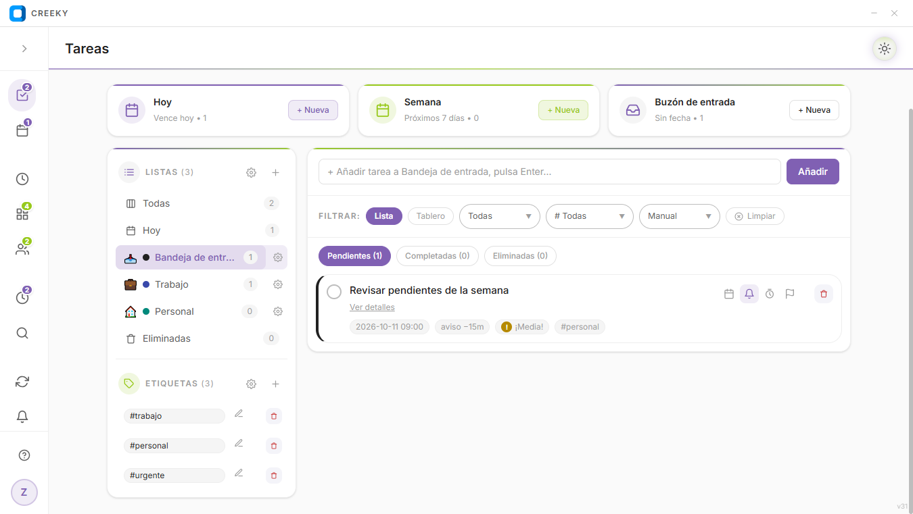

<h1 align="center">
  Creeky
</h1>

<p align="center">
  <b>English</b> · <a href="README.es.md">Español</a>
</p>

<p align="center">
  
  
  
  
  
  
  
  
</p>

<p align="center">
  
</p>

Creeky is a personal productivity desktop app for Windows that keeps tasks, time and habits in one place. Everything runs locally, with no servers: your data lives in a SQLite database on your computer and each account has its own.

---

## Features

- **Tasks and lists** with priority, date, duration, weekly repetition, tags and description. List view and Kanban board with drag and drop.
- **Calendar** with year, month, week, day and list views, connected to tasks by date and repetition.
- **Pomodoro** 25/5/15 with a progress ring, filterable history and session reservation per task.
- **Eisenhower matrix** Q1–Q4 linked to priority; drag to change it.
- **Habits** with a weekly table, streak and best streak, and a daily reminder.
- **Countdown** for manual events and automatically for dated tasks.
- **Search** as you type by title, description and tags, with list, priority and state filters.
- **Notifications** in the app and as native Windows notifications for task alarms and habits.
- **UNAD integration** that signs in to the UNAD Virtual Campus, shows your campus profile and syncs your course agendas into the calendar, with reminders when an activity opens or is about to close.
- **Encrypted backups** exported to a `.dat` file with a one-time recovery key, importable on any account.
- **Profile** with statistics per list and priority, streak and focus.
- **Settings** for language (Spanish and English), window size, starting with Windows and replaying the guided tour.
- **Guided tour** for new users that walks through every section.

---

## Architecture

The frontend is React + TypeScript + Tailwind CSS, organized by feature under `app/src/features/`. The backend is Python on pywebview and owns all the data:

- **Storage**: SQLite through SQLAlchemy at `%APPDATA%\Creeky\user\creeky.db`, with relational tables scoped to each account.
- **Credentials**: password hashes (PBKDF2) and the active session are kept in the Windows Credential Manager through `keyring`; the database never stores passwords.
- **Bridge**: the frontend calls one API method per entity and keeps the latest snapshot in memory.
- **Events**: the backend never calls into the page. It publishes events on the shared pywebview state and the frontend listens for them.
- **Reminders**: a background scheduler fires task and habit reminders and shows them with `desktop-notifier`.
- **Backups**: AES-256-GCM with a key derived by scrypt from a recovery key generated for each export.

---

## Requirements

- Windows 10 or later
- Node 18+
- Python 3.12+

---

## Installation

```bash
git clone https://github.com/Zerik-Official/Creeky
cd Creeky
```

### Backend

```bash
python -m venv venv
venv\Scripts\activate
pip install -r app\requirements.txt
```

### Frontend

```bash
cd app
npm install
copy .env.example .env
```

---

## Running

The desktop window needs the backend, so the app is used through pywebview rather than directly in a browser.

Start the Vite dev server:

```bash
cd app
npm run dev
```

Then, in another terminal, start the desktop window:

```bash
venv\Scripts\activate
python app\desktop\main.py
```

With `DEBUG=true` in `app/.env` the window loads the Vite dev server. Without it the window loads the production build from `app/dist`.

---

## Building the executable

```powershell
.\tools\build.ps1
```

The script builds the frontend and packages the app with PyInstaller in one-folder mode, without a console window and with the application icon. The result is `build\Creeky\Creeky.exe`. When it finishes it asks whether to install the app in a folder of your choice and whether to create a desktop shortcut, which replaces an existing one.

| Parameter | Effect |
| --- | --- |
| `-SkipFrontend` | Reuse the existing `app/dist` output. |
| `-Console` | Keep the console window to read the logs. |
| `-Clean` | Remove the previous build output first. |
| `-InstallDir <path>` | Install into that folder without asking. |
| `-Shortcut` / `-NoShortcut` | Create or skip the desktop shortcut without asking. |
| `-NoPrompt` | Never ask; keep the build where it is. |

---

## Project structure

```
Creeky/
├── tools/
│   └── build.ps1
└── app/
    ├── desktop/
    │   ├── main.py
    │   ├── bootstrap.py
    │   ├── config.py
    │   ├── api/
    │   ├── core/
    │   ├── database/
    │   └── utills/
    ├── src/
    │   ├── App.tsx
    │   ├── main.tsx
    │   ├── components/
    │   ├── features/
    │   ├── hooks/
    │   ├── i18n/
    │   ├── services/
    │   ├── styles/
    │   ├── types/
    │   └── utils/
    ├── index.html
    ├── package.json
    └── requirements.txt
```
